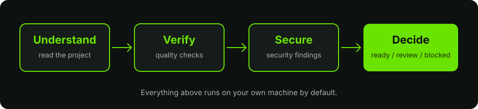

<div align="center">


# Local Audit Agent

**Your AI writes the code. We verify what ships.**

A local-first desktop agent that reads your whole project, then checks quality, security, dependencies and release risk, and tells you plainly whether this version is ready to ship.

[](https://github.com/BIGMOSSX/local-audit-agent/actions/workflows/ci.yml)


**English** · [简体中文](README.zh-CN.md) · [Português (Brasil)](README.pt-BR.md)

</div>

<p align="center"></p>

> [!WARNING]
> **Pre-alpha.** The desktop app, the local daemon and the audit orchestrator work and are tested, but no analysis engine is bundled yet. Today a real run finishes as *completed, partial, no findings, gate: none*, and says so honestly. Do not use it to decide whether to ship. See [Status](#status).

## Why

AI coding tools made writing code fast. Checking it did not get faster. Small teams ship Auth, Payment and Database changes with no QA and no AppSec person, and the real question stays open:

> *"Claude / Cursor just wrote this. Do I dare ship it?"*

Local Audit Agent answers that question on your own computer, in four steps: **Understand** the project, **Verify** it, **Secure** it, **Decide**.

## Highlights

- **Local-first.** Source code, tests, logs, environment variables and evidence stay on your device or in your network. Nothing is uploaded by default.
- **One verdict, not a wall of alerts.** The result is a single gate: ready, needs review, blocked, or "nothing was checked", with a list of what was *not* done and why.
- **Honest by construction.** Green is unreachable unless the checks that matter actually ran. A finding whose only source is model reasoning never blocks a release.
- **Fix prompts you can paste.** Each finding comes with a fixed-template prompt for your coding agent, built only from validated fields so scanned content cannot inject instructions.
- **Locked-down desktop shell.** The window talks to the local daemon through a short allowlist. There is no generic exec or shell method, no auto-updater and no shell/fs/opener plugin for the webview.
- **Two editions in one app.** A standard view for developers and a plain-language BOSS view for the person who has to say yes or no.
- **Windows and macOS.** Both are built and tested in CI.

## How it works

```
 Desktop window (Tauri 2 + React)
        │  17 allowlisted calls, nothing else
        ▼
 Local daemon "auditd"  ── session token, loopback / named pipe, 0700/0600 data dir
        │
        ├─ Orchestrator: background runs, history, cancel, paged findings
        ├─ Engine adapters: code intelligence, quality (more to come)
        └─ Sandbox: project code is never executed in this version
```

| Path | What lives there |
| --- | --- |
| `apps/desktop` | Tauri 2 desktop app (React, HeroUI) |
| `apps/web` | Marketing site (Next.js) |
| `packages/auditd` | Local daemon: handshake, auth, storage, orchestrator |
| `packages/audit-core` | Schemas, gate logic, finding model |
| `packages/engine-*` | Engine adapters |
| `packages/shared` | Shared types, `redactSecrets` |
| `packages/ui`, `packages/design-tokens` | Shared design system, brand colour `#6ae301` |

## Getting started

Requirements: Node ≥ 24, pnpm 9.12, a stable Rust toolchain, and the [Tauri 2 prerequisites](https://v2.tauri.app/start/prerequisites/) for your OS.

```bash
git clone https://github.com/BIGMOSSX/local-audit-agent.git
cd local-audit-agent
pnpm install
pnpm build
pnpm --filter @audit/desktop tauri dev
```

Run the full gate before sending a change:

```bash
pnpm lint && pnpm typecheck && pnpm test && pnpm check:policy
```

## Privacy and security model

- Source code is not uploaded by default. With a local model or offline mode, that always holds.
- A hosted model option is **planned** and is not built yet. When it exists it will be opt-in, will show the destination and the exact content list before anything is sent, and will send only minimised, redacted snippets.
- The daemon session token is never logged or persisted. Anything that could hold a secret goes through `redactSecrets` before a log write.
- This is a defensive tool for code you own or are authorised to audit. It is not an attack or penetration tool.

Found a vulnerability in this project? Please report it privately through GitHub's *Security → Report a vulnerability* instead of opening a public issue.

## Status

| Area | State |
| --- | --- |
| Desktop home, drag-and-drop project import | Done, checked on a real Mac |
| Local model detection (loopback) | Done |
| Local daemon, token auth, restart recovery | Done, 22/22 checks on a real Mac |
| Orchestrator: background runs, history, cancel | Done |
| Four-gate running screen and result page | Done, tested with fakes |
| BOSS edition | Committed, not yet verified in a real window |
| Analysis engines bundled and installable | **Not yet** |
| Hosted model, accounts, billing | Not started |
| Windows window behaviour on real hardware | CI only |
| Signed installers and updates | Not started |

Verification records live in [`docs/verification`](docs/verification).

## Contributing

Issues and pull requests are welcome. The working rules are in [`AGENTS.md`](AGENTS.md): write the test first, run `pnpm lint`, `pnpm typecheck`, `pnpm test`, `pnpm build` and `pnpm check:policy`, and keep the renderer-to-daemon allowlist closed.

## License

Licensed under the [Apache License 2.0](LICENSE).
