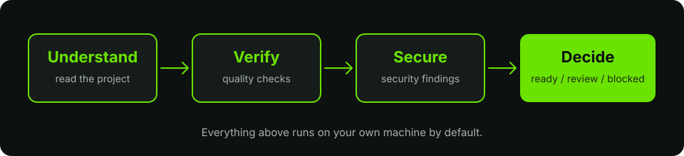
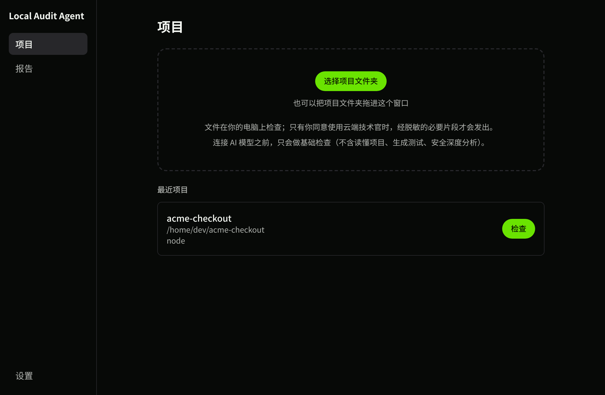
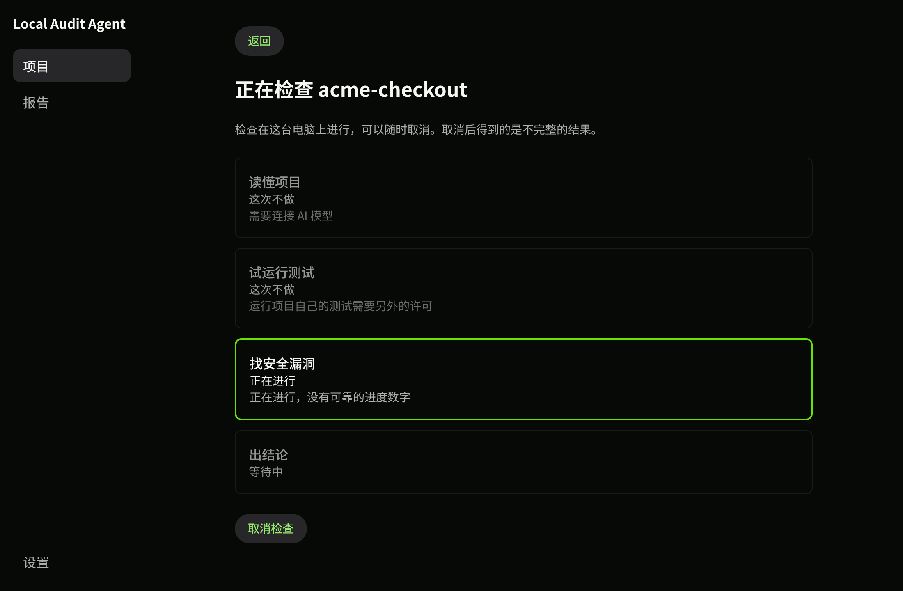
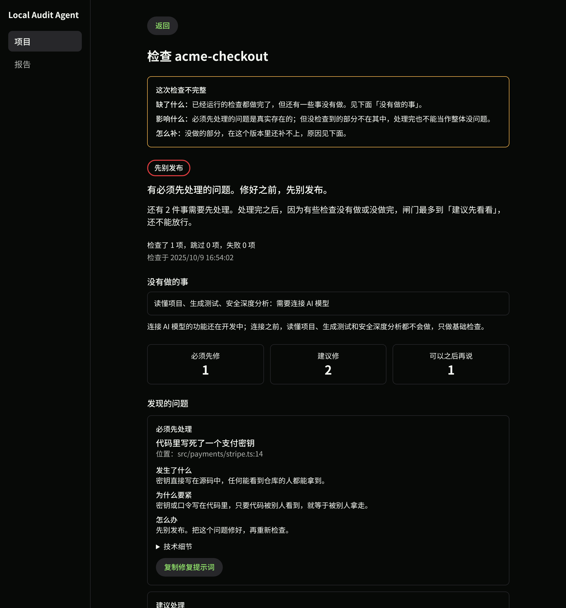
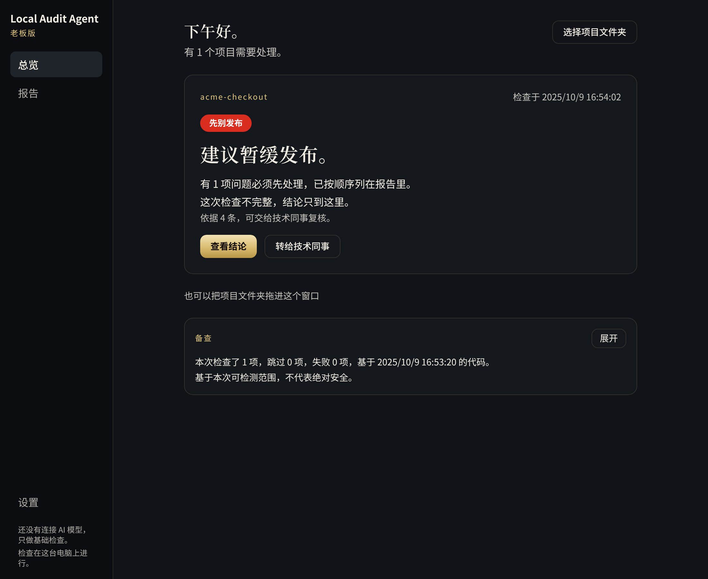
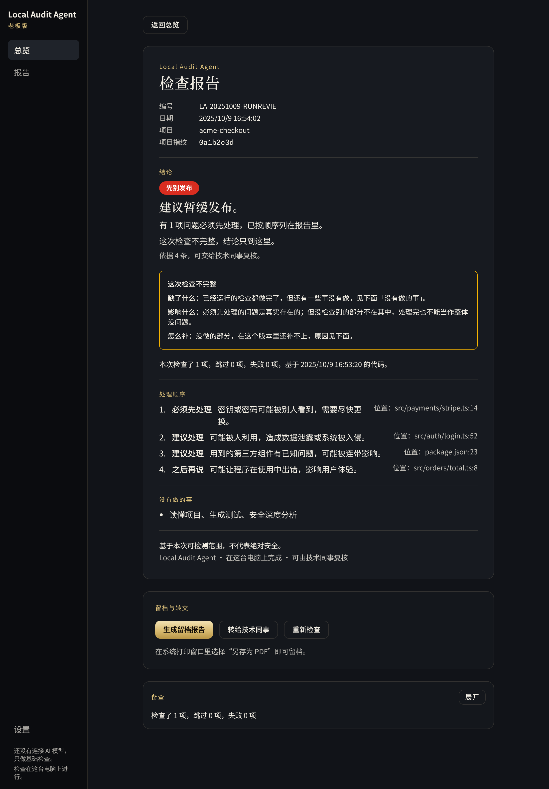

<div align="center">


# Local Audit Agent

**Sua IA escreve o código. Nós verificamos o que vai para produção.**

Um agente de auditoria para desktop, local em primeiro lugar: ele lê o projeto inteiro, verifica qualidade, segurança, dependências e risco de release, e diz com clareza se esta versão está pronta para ir ao ar.

[](https://github.com/BIGMOSSX/local-audit-agent/actions/workflows/ci.yml)


[English](README.md) · [简体中文](README.zh-CN.md) · **Português (Brasil)**

</div>

<p align="center"></p>

> [!WARNING]
> **Pré-alfa.** O app desktop, o daemon local e o orquestrador de auditoria funcionam e têm testes, mas ainda não há nenhum motor de análise incluído. Hoje uma execução real termina como *concluída, parcial, sem achados, portão: nenhum*, e diz isso de forma honesta. Não use o app para decidir se algo vai para produção. Veja o [Status](#status).

## Capturas de tela

<p align="center">  </p>

1. Escolha um projeto: selecione uma pasta ou solte-a na janela.
2. Os quatro portões durante a verificação. O que é pulado aparece como pulado, nunca como feito.
3. Um veredito, o que não foi verificado e os achados com um prompt de correção copiável.

**Edição BOSS**: as mesmas verificações, escritas para quem precisa dizer sim ou não.

<p align="center"> </p>

*Dados de um projeto de exemplo. A interface está, por enquanto, apenas em chinês; mais idiomas estão planejados.*

## Por que isso existe

As ferramentas de IA tornaram escrever código rápido. Verificar o código não ficou mais rápido. Equipes pequenas publicam mudanças de login, pagamento e banco de dados sem QA e sem ninguém de segurança, e a pergunta real continua sem resposta:

> *"O Claude / Cursor acabou de escrever isso. Posso publicar?"*

O Local Audit Agent responde a essa pergunta no seu próprio computador, em quatro passos: **Understand** (entender) o projeto, **Verify** (verificar), **Secure** (proteger) e **Decide** (decidir).

## Destaques

- **Local em primeiro lugar.** Código-fonte, testes, logs, variáveis de ambiente e evidências ficam no seu dispositivo ou na sua rede. Por padrão, nada é enviado.
- **Um veredito, não uma enxurrada de alertas.** O resultado é um único portão: pronto, revisar, bloqueado ou "nada foi verificado", com a lista do que **não** foi feito e o motivo.
- **Honesto por construção.** O verde é inalcançável se as verificações que importam não rodaram de fato. Um achado cuja única fonte é o raciocínio do modelo nunca bloqueia uma release.
- **Prompts de correção prontos para colar.** Cada achado vem com um prompt de modelo fixo para o seu agente de código, montado só com campos validados, para que o conteúdo analisado não consiga injetar instruções.
- **Casca desktop restrita.** A janela fala com o daemon local por uma lista curta de chamadas permitidas. Não há método genérico de exec ou shell, nem atualizador automático, nem plugin de shell/fs/opener para a webview.
- **Duas edições em um app.** Uma visão padrão para desenvolvedores e uma visão BOSS, em linguagem simples, para quem precisa dizer sim ou não.
- **Windows e macOS.** Ambos são compilados e testados no CI.

## Como funciona

```
 Janela desktop (Tauri 2 + React)
        │  17 chamadas permitidas, nada além disso
        ▼
 Daemon local "auditd" ── token de sessão, loopback / named pipe, diretório de dados 0700/0600
        │
        ├─ Orquestrador: execuções em segundo plano, histórico, cancelamento, achados paginados
        ├─ Adaptadores de motor: inteligência de código, qualidade (mais por vir)
        └─ Sandbox: o código do projeto nunca é executado nesta versão
```

| Caminho | O que contém |
| --- | --- |
| `apps/desktop` | App desktop Tauri 2 (React, HeroUI) |
| `apps/web` | Site institucional (Next.js) |
| `packages/auditd` | Daemon local: handshake, autenticação, armazenamento, orquestrador |
| `packages/audit-core` | Esquemas, lógica dos portões, modelo de achados |
| `packages/engine-*` | Adaptadores de motor |
| `packages/shared` | Tipos compartilhados, `redactSecrets` |
| `packages/ui`, `packages/design-tokens` | Design system compartilhado, cor da marca `#6ae301` |

## Primeiros passos

Requisitos: Node ≥ 24, pnpm 9.12, toolchain estável do Rust e os [pré-requisitos do Tauri 2](https://v2.tauri.app/start/prerequisites/) para o seu sistema.

```bash
git clone https://github.com/BIGMOSSX/local-audit-agent.git
cd local-audit-agent
pnpm install
pnpm build
pnpm --filter @audit/desktop tauri dev
```

Rode o conjunto completo de verificações antes de enviar uma mudança:

```bash
pnpm lint && pnpm typecheck && pnpm test && pnpm check:policy
```

## Privacidade e modelo de segurança

- O código-fonte não é enviado por padrão. Com um modelo local ou no modo offline, isso sempre vale.
- Uma opção de modelo hospedado está **planejada** e ainda não foi construída. Quando existir, será opcional, mostrará o destino e a lista exata de conteúdo antes de enviar qualquer coisa, e enviará apenas trechos minimizados e com dados sensíveis removidos.
- O token de sessão do daemon nunca é registrado em log nem gravado em disco. Tudo que possa conter um segredo passa por `redactSecrets` antes de ir para um log.
- Esta é uma ferramenta defensiva para código seu ou que você tem autorização para auditar. Não é uma ferramenta de ataque nem de teste de intrusão.

Encontrou uma vulnerabilidade neste projeto? Reporte em particular pelo GitHub em *Security → Report a vulnerability*, em vez de abrir uma issue pública.

## Status

| Área | Estado |
| --- | --- |
| Tela inicial do desktop, importar projeto arrastando | Pronto, verificado em um Mac real |
| Detecção de modelo local (loopback) | Pronto |
| Daemon local, autenticação por token, recuperação após reinício | Pronto, 22/22 verificações em um Mac real |
| Orquestrador: execuções em segundo plano, histórico, cancelamento | Pronto |
| Tela de execução com quatro portões e página de resultado | Pronto, testado com dados simulados |
| Edição BOSS | Commitada, ainda não verificada em uma janela real |
| Motores de análise incluídos e instaláveis | **Ainda não** |
| Modelo hospedado, contas, cobrança | Não iniciado |
| Comportamento da janela no Windows em hardware real | Somente CI |
| Instaladores assinados e atualizações | Não iniciado |

Os registros de verificação estão em [`docs/verification`](docs/verification).

## Contribuindo

Issues e pull requests são bem-vindos. As regras de trabalho estão em [`AGENTS.md`](AGENTS.md): escreva o teste primeiro, rode `pnpm lint`, `pnpm typecheck`, `pnpm test`, `pnpm build` e `pnpm check:policy`, e mantenha fechada a lista de chamadas permitidas entre o renderer e o daemon.

## Licença

Licenciado sob a [Apache License 2.0](LICENSE).
