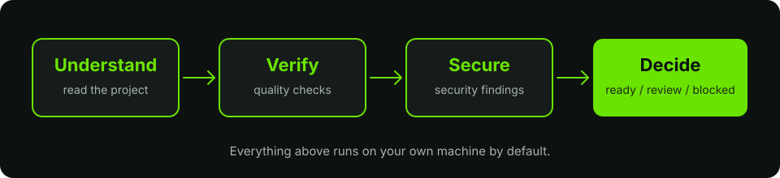
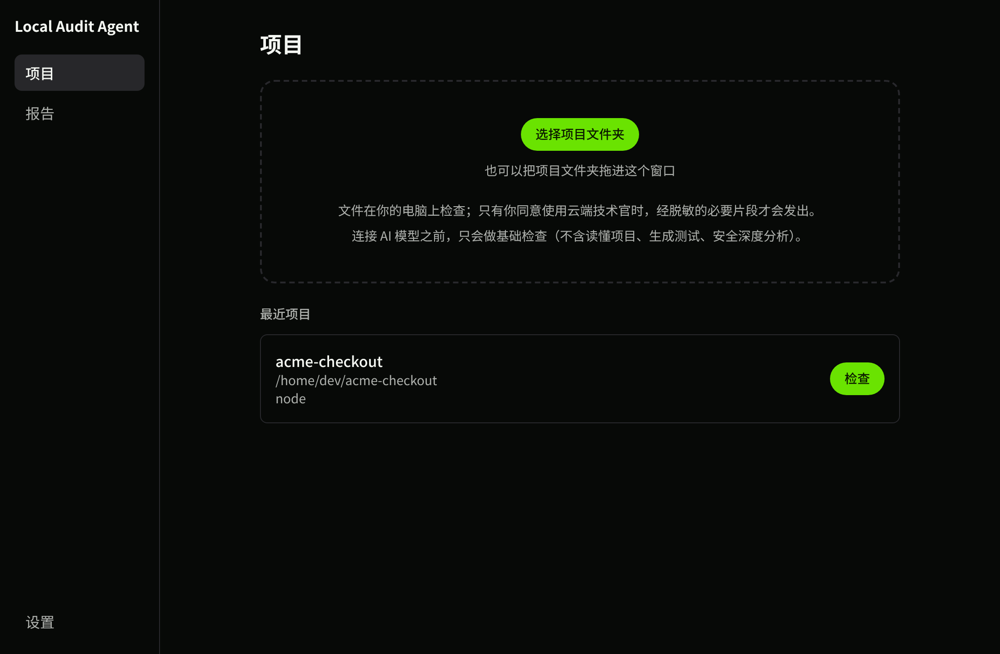
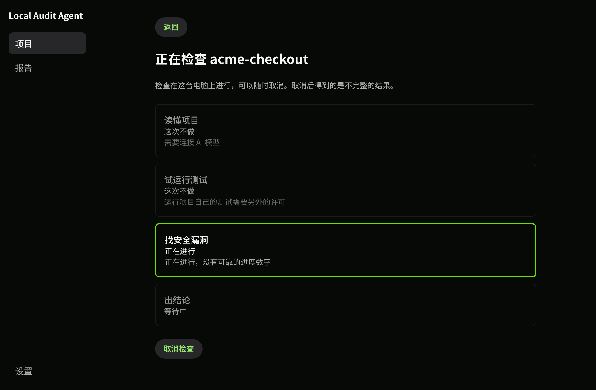
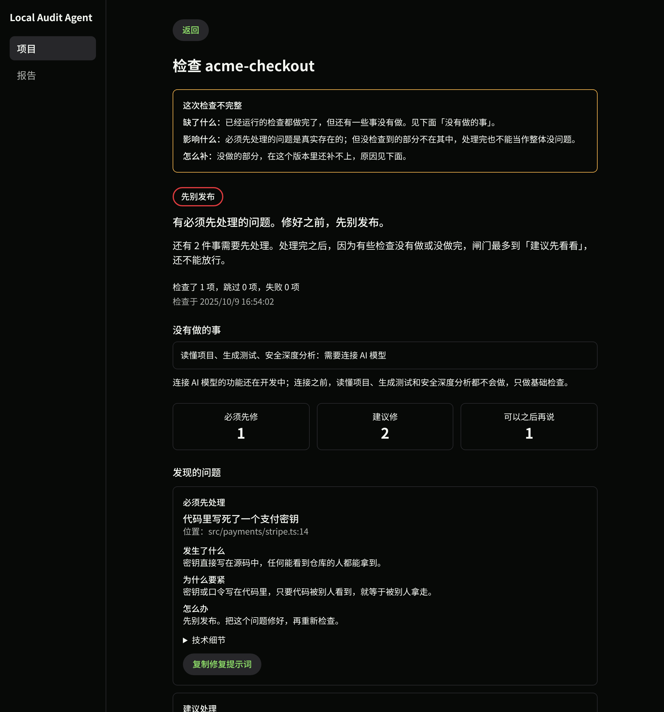
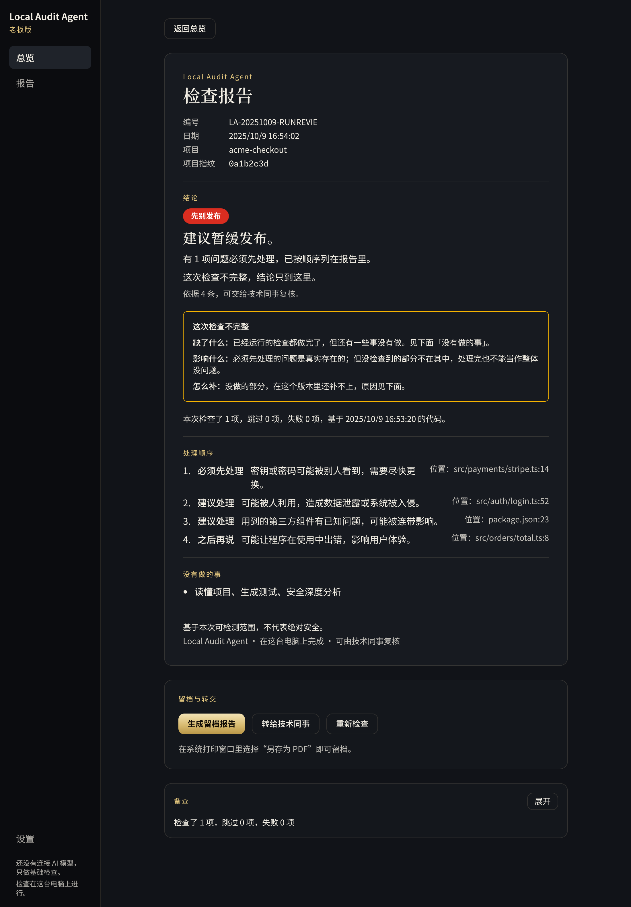

<div align="center">


# Local Audit Agent

**AI 负责写代码，我们负责验证能不能上线。**

本地优先的桌面审计智能体：先读懂整个项目，再检查质量、安全、依赖和发布风险，最后直接告诉你这个版本能不能发。

[](https://github.com/BIGMOSSX/local-audit-agent/actions/workflows/ci.yml)


[English](README.md) · **简体中文** · [Português (Brasil)](README.pt-BR.md)

</div>

<p align="center"></p>

> [!WARNING]
> **早期阶段（pre-alpha）。** 桌面端、本地守护进程和审计编排器已可用并有测试覆盖，但分析引擎还没有随包提供。目前真实运行的结果是「已完成、部分检查、无发现、闸门：未检查」，并且会如实写明。请不要用它来决定是否发版。详见[当前进度](#当前进度)。

## 界面截图

<p align="center">  </p>

1. 选择项目：点选文件夹，或直接拖进窗口。
2. 检查中的四个闸门。没做的会明确标成「这次不做」，不会假装做完。
3. 一个结论、没检查到的部分，以及每条发现附带的可复制修复提示词。

**老板版（BOSS 版）**：同样的检查，写给要拍板的人看。

<p align="center"> </p>

*截图使用的是示例项目数据。*

## 为什么做这个

AI 写代码变快了，验证代码的速度没有跟上。小团队在没有测试、没有安全人员的情况下，把登录、支付、数据库的改动直接发出去，真正的问题始终没人回答：

> *「这是 Claude / Cursor 刚写的，我敢上线吗？」*

Local Audit Agent 在你自己的电脑上回答这个问题，分四步：**读懂**项目（Understand）、**验证**（Verify）、**查安全**（Secure）、**下结论**（Decide）。

## 特性

- **本地优先。** 源码、测试、日志、环境变量和检查证据默认留在你的设备或内网，不上传。
- **一个结论，而不是一堆告警。** 结果只有一个闸门：可以发布、建议先看看、先别发，或「这次没有完成任何检查」，并列出**没做**的部分和原因。
- **结构上就诚实。** 关键检查没有真正跑完，就不可能出现绿色。只由模型推理得出的发现，永远不会拦住发版。
- **可直接粘贴的修复提示词。** 每条发现都附带一段固定模板的提示词，只用校验过的字段生成，被扫描的内容无法往里注入指令。
- **收紧的桌面外壳。** 窗口只能通过一份很短的白名单调用本地守护进程；没有通用的 exec / shell 方法，没有自动更新，也没有给网页层开放 shell / fs / opener 插件。
- **一个应用，两个版本。** 给开发者的标准版，和给「要拍板的人」看的老板版（BOSS 版）。
- **Windows 与 macOS。** 两个平台都在 CI 中构建和测试。

## 工作方式

```
 桌面窗口（Tauri 2 + React）
        │  仅 17 个白名单调用，没有别的通道
        ▼
 本地守护进程 auditd ── 会话令牌、本机回环 / 命名管道、数据目录 0700/0600
        │
        ├─ 编排器：后台运行、历史记录、取消、分页的发现列表
        ├─ 引擎适配器：代码理解、质量检查（后续会增加）
        └─ 沙箱：当前版本不会运行被检查项目的代码
```

| 路径 | 内容 |
| --- | --- |
| `apps/desktop` | Tauri 2 桌面应用（React、HeroUI） |
| `apps/web` | 官网（Next.js） |
| `packages/auditd` | 本地守护进程：握手、鉴权、存储、编排器 |
| `packages/audit-core` | 数据结构、闸门逻辑、发现模型 |
| `packages/engine-*` | 引擎适配器 |
| `packages/shared` | 公共类型、`redactSecrets` |
| `packages/ui`、`packages/design-tokens` | 共用设计系统，品牌色 `#6ae301` |

## 快速开始

环境要求：Node ≥ 24、pnpm 9.12、稳定版 Rust 工具链，以及你所在系统的 [Tauri 2 前置依赖](https://v2.tauri.app/start/prerequisites/)。

```bash
git clone https://github.com/BIGMOSSX/local-audit-agent.git
cd local-audit-agent
pnpm install
pnpm build
pnpm --filter @audit/desktop tauri dev
```

提交改动前跑完整闸门：

```bash
pnpm lint && pnpm typecheck && pnpm test && pnpm check:policy
```

## 隐私与安全模型

- 源码默认不上传。使用本机模型或离线模式时，这一点始终成立。
- 托管模型选项**还在规划中**，尚未实现。上线后它将是用户主动开启的：发送前会显示目的地和完整内容清单，且只发送经过最小化和脱敏的片段。
- 守护进程的会话令牌从不写日志、不落盘。任何可能含密钥的内容，写日志前都要经过 `redactSecrets`。
- 这是面向「你自己的代码、或已获授权的代码」的防御性工具，不是攻击或渗透工具。

如果你在本项目中发现了安全漏洞，请通过 GitHub 的 *Security → Report a vulnerability* 私下报告，不要公开提 issue。

## 当前进度

| 模块 | 状态 |
| --- | --- |
| 桌面首页、拖拽导入项目 | 已完成，在真实 Mac 上验证 |
| 本机模型检测（回环地址） | 已完成 |
| 本地守护进程、令牌鉴权、重启恢复 | 已完成，真实 Mac 上 22/22 项通过 |
| 编排器：后台运行、历史、取消 | 已完成 |
| 四闸门检查中界面与结果页 | 已完成，用模拟数据测试 |
| BOSS 版 | 已提交，尚未在真实窗口验证 |
| 分析引擎随包提供、可安装 | **尚未完成** |
| 托管模型、账号、计费 | 未开始 |
| Windows 真机窗口表现 | 仅 CI |
| 签名安装包与更新 | 未开始 |

验证记录见 [`docs/verification`](docs/verification)。

## 参与贡献

欢迎提 issue 和 pull request。开发规则见 [`AGENTS.md`](AGENTS.md)：先写测试，跑通 `pnpm lint`、`pnpm typecheck`、`pnpm test`、`pnpm build` 和 `pnpm check:policy`，并保持渲染层到守护进程的白名单不被放宽。

## 许可证

采用 [Apache License 2.0](LICENSE) 许可。
